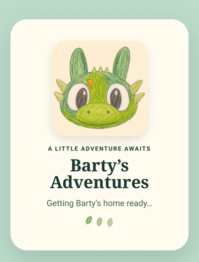

Almost three months since my last post on the point and click game, with almost zero progress. But re-reading my last post, one of the reasons for removing my first game from the app stores was the constant effort to maintain the app and not really making any money in return. That effort now is very low using AI, so I'm thinking of maybe reviving the first one. I'll post an update on that if I do. I'll ping my friend the designer; maybe he wants to give it a go again.

I did start another game as a project with my younger daughter. Some time ago we made up a bedtime story, and I thought it'd be fun to work together on a game that tells the story and maybe she can play with her friends. Let's see how that goes. The game is called Barty's Adventures.

That's Barty's Adventures load screen, and that's Barty the dragon!